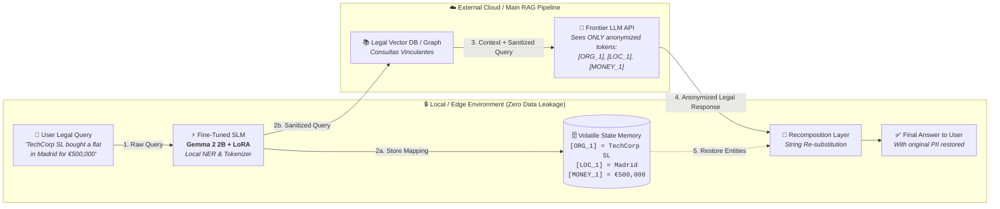
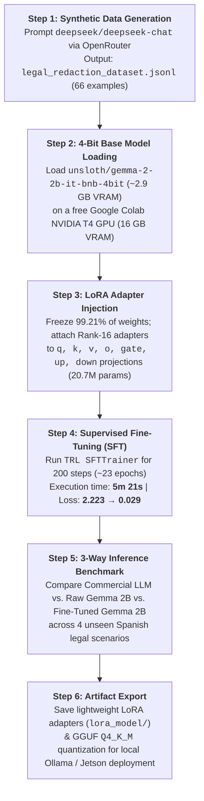
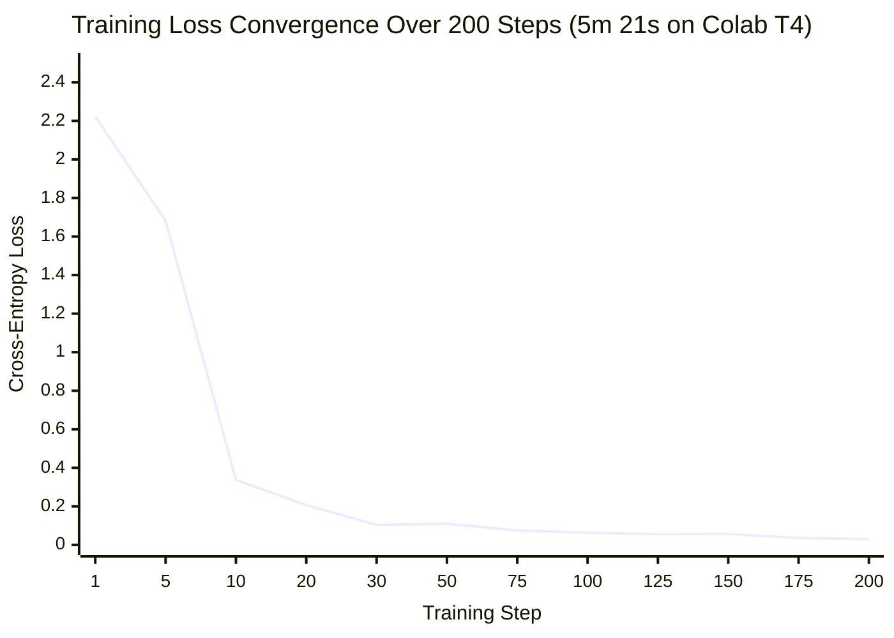

<div align="center">

# 🛡️ SLM Fine-Tuning for Legal PII Masking & Re-Identification

**An educational, hands-on deep dive into fine-tuning a lightweight Open-Source Small Language Model (Gemma 2 2B) with QLoRA & Unsloth to act as a local, zero-latency PII privacy firewall for LegalTech RAG pipelines.**

[](https://colab.research.google.com/github/manumezog/linde-slm-finetune-PIImasking/blob/main/slm_finetuning_v2.ipynb)
[-blue)](https://huggingface.co/unsloth/gemma-2-2b-it-bnb-4bit)
[](https://github.com/unslothai/unsloth)
[-success)](#4-training-configuration--loss-convergence)
[](./LICENSE)

</div>

---

## 🎯 About This Project (Why I Built It)

> [!NOTE]
> **Personal Learning & Curiosity Project:** This repository was created strictly out of personal curiosity to learn, test, and demystify **how to fine-tune lightweight Open-Source Small Language Models (SLMs)** for narrow, deterministic tasks using **100% free cloud resources** (Google Colab T4 GPU) and modern open-source libraries (`Unsloth`, `PEFT/LoRA`, `TRL`).

When building AI assistants, RAG pipelines, or Knowledge Graphs for sensitive domains—such as **Spanish tax and legal consultations** (*Consultas Vinculantes de la DGT*, corporate M&A, or inheritance law)—users inevitably type real **Personally Identifiable Information (PII)** into their prompts:
- Company names (*Innovaciones Digitales SL*)
- Tax IDs (*NIF/CIF/DNI*)
- Personal names (*Carlos Ruíz*)
- Street addresses & cities (*Calle Balmes 45, Barcelona*)
- Exact financial figures (*1.200.000€*)

Sending raw PII to third-party commercial LLM APIs introduces severe **GDPR/privacy compliance risks**. However, traditional regex rules are too brittle for context-dependent entities, and using a massive general-purpose LLM just to sanitize prompts adds unnecessary latency, cost, and conversational noise.

**The Goal:** Can we take a tiny **2.6-billion parameter open-source model (`Gemma 2 2B`)**, generate a synthetic dataset for pennies, and fine-tune it in **under 6 minutes** on a free GPU so it acts as a **deterministic, local PII tokenizer and lookup-table generator**?

---

## 🏗️ The Target Architecture: 4-Step PII Tokenization & Re-Identification Firewall

Instead of exposing sensitive user data to an external LLM, the fine-tuned SLM sits at the edge (or local backend layer) as a privacy firewall:



### Why an SLM Instead of Regex or a General-Purpose LLM?

| Approach | Context Awareness | Schema Determinism | Data Privacy (On-Prem/Edge) | Latency & Cost |
| :--- | :---: | :---: | :---: | :---: |
| **Regex / Rules** | ❌ Rigid, misses context | ✅ High | ✅ Local | ⚡ Instant / Free |
| **General Cloud LLM (Zero-Shot)** | ✅ High | ⚠️ Conversational, inconsistent tags | ❌ Sends PII to external API | 🐢 Network RTT + API Cost |
| **Raw Base SLM (Untrained 2B)** | ⚠️ Struggles without tuning | ❌ Hallucinates explanations | ✅ Local | ⚡ Fast / Free |
| **Fine-Tuned SLM (Gemma 2B + LoRA)** | ✅ Context-aware | ✅ **Strict 2-line schema** | ✅ **100% Local / Edge Ready** | ⚡ **Milliseconds / Free** |

---

## 📂 Repository Contents

```text
linde-slm-finetune-PIImasking/
├── README.md                          # Visual & educational documentation of the project
├── slm_finetuning_v2.ipynb            # End-to-end Google Colab Notebook (Data Gen -> QLoRA -> 3-Way Benchmark)
├── legal_redaction_dataset.jsonl      # Synthetic dataset (66 Spanish legal/tax PII redaction pairs)
├── lora_model/                        # Trained LoRA Adapter weights (~80MB) & tokenizer configuration
│   ├── adapter_config.json            # PEFT LoRA configuration (r=16, alpha=16, Gemma 2 2B)
│   ├── adapter_model.safetensors      # Fine-tuned low-rank adapter matrices (0.79% of model weights)
│   ├── tokenizer.json                 # Tokenizer vocabulary & merges
│   ├── tokenizer.model                # SentencePiece model asset
│   ├── tokenizer_config.json          # Tokenizer configuration
│   ├── chat_template.jinja            # Chat template
│   └── README.md                      # Model Card for the LoRA adapter
└── LICENSE                            # MIT License
```

---

## 🔬 End-to-End Methodology



### 1. Selecting the Right Open-Weight Base Model

Before training, several small open-weight models capable of fitting comfortably inside 8–16 GB of VRAM (and edge devices like an NVIDIA Jetson Orin Nano) were evaluated:

| Model | Parameters | Context Window | VRAM (4-bit Quantized) | Primary Strength for Legal / NER Tasks |
| :--- | :--- | :--- | :--- | :--- |
| **Gemma 2 (2B)** ⭐ *Selected* | 2.6 Billion | 8,192 tokens | ~2.9 GB | Exceptional structural reasoning and instruction-following; highly precise at mapping entities to standardized tags. |
| **Qwen 2.5 (1.5B)** | 1.5 Billion | 32,768 tokens | ~1.8 GB | Ultra-fast inference speed and strong multilingual support on constrained edge hardware. |
| **Llama 3.2 (1B)** | 1.2 Billion | 128,000 tokens | ~1.5 GB | Massive context window for its footprint; ideal for long document chunks. |
| **Llama 3.2 (3B)** | 3.2 Billion | 128,000 tokens | ~3.4 GB | Higher baseline intelligence, balancing context size with legal terminology comprehension. |

### 2. Synthetic Dataset Generation (`legal_redaction_dataset.jsonl`)

Instead of manually labeling data, we used **DeepSeek (`deepseek/deepseek-chat`)** via the **OpenRouter API** with `response_format: {"type": "json_object"}` to synthesize Spanish legal queries paired with their sanitized text and entity mapping.

Each training record in [`legal_redaction_dataset.jsonl`](./legal_redaction_dataset.jsonl) follows this structure:

```json
{
  "instruction": "Redact all PII (organizations, people, locations, financial amounts, and IDs) from the following legal query and provide the mapping.",
  "input": "Quiero saber si puedo transferir mi propiedad en Valencia valorada en €300,000 a mi hija María González.",
  "output": "Quiero saber si puedo transferir mi propiedad en [LOC_1] valorada en [MONEY_1] a mi hija [PER_1].\nMapping: [LOC_1] = Valencia, [MONEY_1] = €300,000, [PER_1] = María González"
}
```

### 3. Parameter-Efficient Fine-Tuning with Unsloth & QLoRA

Rather than performing full fine-tuning (which updates all 2.63 billion parameters and requires expensive multi-GPU clusters), we use **QLoRA (4-bit Quantized Low-Rank Adaptation)**:
- **Base Model:** `unsloth/gemma-2-2b-it-bnb-4bit`
- **Total Parameters:** `2,635,108,608`
- **Trainable LoRA Parameters:** `20,766,720` (**only `0.79%` of total weights!**)
- **LoRA Hyperparameters:** `r = 16`, `lora_alpha = 16`, `lora_dropout = 0`, `bias = "none"`
- **Target Modules:** `["q_proj", "k_proj", "v_proj", "o_proj", "gate_proj", "up_proj", "down_proj"]`
- **Training Setup:** `per_device_train_batch_size = 2`, `gradient_accumulation_steps = 4` (Effective Batch Size = 8), `optim = "adamw_8bit"`, `learning_rate = 2e-4`, `fp16 = True`, `max_steps = 200`.

### 4. Training Configuration & Loss Convergence

Training 200 steps (~23 epochs over the 66 examples) on a **free Google Colab Tesla T4 GPU** took just **5 minutes and 21 seconds**.



- **Steps 1–10:** Rapid structural alignment (Loss drops from `2.223` to `0.337` in the first 10 steps as the model learns the exact two-line `Sanitized + Mapping:` output template).
- **Steps 10–100:** Entity tagging refinement (`0.337` → `0.063`).
- **Steps 100–200:** Fine convergence (`0.063` → `0.0295`).

---

## 📊 3-Way Inference Benchmark: The Real Value of Fine-Tuning

To objectively verify what the LoRA fine-tuning achieved, Cell 5 of [`slm_finetuning_v2.ipynb`](./slm_finetuning_v2.ipynb) runs a **3-way side-by-side benchmark** across **4 unseen Spanish legal queries**, comparing:
1. **1️⃣ Commercial General LLM (`deepseek/deepseek-chat` via OpenRouter, zero-shot)**
2. **2️⃣ Raw Base Open-Source SLM (`Gemma 2 2B Instruct` untrained, using `with model.disable_adapter():`)**
3. **3️⃣ Fine-Tuned Open-Source SLM (`Gemma 2 2B + Our Trained LoRA Adapter`)**

### Scenario 1: Real Estate / Corporate Asset Purchase
> **📥 Input Query:** *"La empresa Innovaciones Digitales SL, con NIF B98765432, compró un servidor en Madrid por 15.000€ a través del apoderado Carlos Ruíz."*

| Model | Actual Output | Engineering Verdict |
| :--- | :--- | :--- |
| **1️⃣ Commercial LLM**<br/>*(DeepSeek Chat)* | `**Redacted Text:**`<br/>`La empresa [ORGANIZATION_1], con NIF [ID_1], compró un servidor en [LOCATION_1] por [AMOUNT_1]€ a través del apoderado [PERSON_1].`<br/>`**Mapping:**`<br/>`- [ORGANIZATION_1]: Innovaciones Digitales SL`<br/>`- [ID_1]: B98765432`<br/>`- [LOCATION_1]: Madrid`<br/>`- [AMOUNT_1]: 15.000`<br/>`- [PERSON_1]: Carlos Ruíz` | ⚠️ **Good extraction, non-standard schema:** Invents its own tag names (`[ORGANIZATION_1]`, `[AMOUNT_1]`), leaves the `€` sign outside the token, and uses Markdown bolding + bullet lists. |
| **2️⃣ Raw Base SLM**<br/>*(Gemma 2B Untrained)* | `**Redacted Query:**`<br/>`[Redacted]`<br/>`**Mapping:**`<br/>`* **Company:** Innovaciones Digitales SL ...`<br/>`### Explanation:`<br/>`The input text contains several pieces of information that can be considered PII... Let me know if you have any other legal queries you'd like me to redact!` | ❌ **Unusable for a pipeline:** Replaces the entire sentence with `[Redacted]`, switches to English, and writes a long conversational essay. |
| **3️⃣ Fine-Tuned SLM**<br/>*(Gemma 2B + LoRA)* | `La empresa [ORG_1] con [ID_1] compró un servidor en [LOC_1] por [MONEY_1] a través del apoderado [PER_1].`<br/>`Mapping: [ORG_1] = Innovaciones Digitales SL, [ID_1] = B98765432, [LOC_1] = Madrid, [MONEY_1] = 15.000€, [PER_1] = Carlos Ruíz` | ✅ **Spot-on:** Zero conversational filler, exact `[ORG_1]`, `[ID_1]`, `[LOC_1]`, `[MONEY_1]`, `[PER_1]` tags, and clean single-line `Mapping:` ready for regex/dict parsing. |

---

### Scenario 3: Corporate Restructuring / Mergers
> **📥 Input Query:** *"La sociedad Grupo Logístico del Norte SA (CIF A55443322) ha firmado una fusión con Transportes Ibéricos SL en Valencia por un importe de 1.200.000€."*

- **1️⃣ Commercial LLM (DeepSeek):** Adds conversational intro (`"Here's the redacted version with the mapping:"`) and outro (`"This preserves the legal structure while removing..."`), using `[ORGANIZATION_1]` and `[FINANCIAL_AMOUNT_1]`.
- **2️⃣ Raw Base SLM (Gemma 2B Untrained):** Outputs `[Redacted text]` for both the query and every single mapping value (`* **Valencia:** [Redacted text]`), destroying the lookup table completely.
- **3️⃣ Fine-Tuned SLM (Gemma 2B + LoRA):**
  ```text
  La sociedad [ORG_1] (CIF [ORG_2]) ha firmado una fusión con [ORG_3] SL en [LOC_1] por un importe de [MONEY_1].
  Mapping: [ORG_1] = Grupo Logístico del Norte SA, [ORG_2] = A55443322, [ORG_3] = Transportes Ibéricos SL, [LOC_1] = Valencia, [MONEY_1] = 1.200.000€.
  ```

---

### Scenario 4: Labor Law / Severance Pay
> **📥 Input Query:** *"El empleado Antonio Fernández ha finalizado su contrato con la firma Consultoría Tech SL recibiendo una indemnización de 42.500€ liquidados en Sevilla."*

- **1️⃣ Commercial LLM (DeepSeek):** Changes its mapping delimiter from `=` (used in Scenario 3) to Unicode arrows `→` (`[PERSON_1] → Antonio Fernández`), illustrating why zero-shot general LLMs break deterministic backend parsers across consecutive API calls!
- **2️⃣ Raw Base SLM (Gemma 2B Untrained):** Translates the Spanish query into English (`"The employee [REDACTED] has finalized his contract..."`) and appends a 10-line explanation.
- **3️⃣ Fine-Tuned SLM (Gemma 2B + LoRA):**
  ```text
  El empleado [PER_1] ha finalizado su contrato con la firma [ORG_1] recibiendo una indemnización de [MONEY_1] liquidados en [LOC_1].
  Mapping: [PER_1] = Antonio Fernández, [ORG_1] = Consultoría Tech SL, [MONEY_1] = 42.500€, [LOC_1] = Sevilla
  ```

---

## 💡 Key Findings, Edge Cases & Engineering Learnings

This hands-on experiment yielded several practical takeaways for anyone looking to fine-tune SLMs:

### 1. Fine-Tuning Turns a "Chatty" 2B Model into a Deterministic Function
Out of the box, `Gemma 2 2B Instruct` is trained to be a helpful, chatty assistant—so when asked to redact PII, it writes paragraphs in English explaining *what* PII is. Training just **0.79% of its weights** for **5 minutes** completely suppresses conversational preamble and locks the model into a strict, machine-parsable output format. Meanwhile, even a strong commercial LLM (`DeepSeek Chat`) varied its tag names (`[AMOUNT_1]` vs `[FINANCIAL_AMOUNT_1]`) and delimiters (`:` vs `=` vs `→`) across the 4 test queries.

### 2. The "Synthetic Dataset Bias" Discovery (Why Scenario 2 Failed)
In **Scenario 2** (*"Mi madre, Maria del Carmen Gómez (DNI 12345678A), quiere donarme un inmueble en Calle Balmes 45, Barcelona valorado en 280.000€."*), our fine-tuned SLM produced an incomplete mapping:
```text
Mi madre, [PER_1], [PER_2] (ID_1), quiere donarme un inmueble en [LOC_1] valorado en [MONEY_1].
Mapping: [PER_1], [PER_2], ID_1, [LOC_1], [MONEY_1]
```
**Why did this happen?** Inspecting our 66 generated rows in [`legal_redaction_dataset.jsonl`](./legal_redaction_dataset.jsonl) revealed the root cause:
- Even though our prompt to DeepSeek asked for `organizations, people, locations, financial amounts, and IDs`, the 66 examples DeepSeek generated in a single shot **only contained simple cities (`Barcelona`, `Madrid`), simple 2-word names (`Juan Pérez`), companies, and Euro amounts**.
- **Zero examples** in `legal_redaction_dataset.jsonl` actually contained a `DNI/NIF/CIF` (`[ID_1]`) or a full street address (`Calle Balmes 45, Barcelona`)!
- **Lesson Learned:** *An SLM is a mirror of its training distribution.* When the 2B model encountered a 4-word compound name (`Maria del Carmen Gómez`), a `DNI`, and a street address all at once, it encountered out-of-distribution patterns. Generating smaller, targeted batches (e.g., 25 examples specifically with DNIs/NIEs/CIFs and compound addresses) and validating tag coverage before training is essential.

### 3. LoRA Adapters (`lora_model/`) vs. Merged GGUF (`.gguf`)
- **LoRA Adapters (`~80 MB` in [`lora_model/`](./lora_model)):** Contains only the trained low-rank matrices. Ideal for version control on GitHub/Hugging Face and fast in-notebook inference via `PEFT`/`Unsloth`.
- **Full Merged GGUF (`~1.6 GB` `Q4_K_M`):** Merges the LoRA weights back into the base model and quantizes for standalone C++ execution (`llama.cpp` / `Ollama`). Note that in Google Colab, `files.download()` in the browser frequently fails on files >1 GB; mounting Google Drive (`drive.mount('/content/drive')`) is the reliable way to export GGUF binaries.

### 4. Hugging Face `401 Unauthorized` Pitfall
When loading models in Colab without a Hugging Face token, requesting a non-existent or misspelled repository ID (such as a placeholder name) triggers an `HTTP 401 Unauthorized / RepositoryNotFoundError` rather than a `404`. Verifying exact model IDs on the Unsloth Hugging Face Hub (e.g., `unsloth/gemma-2-2b-it-bnb-4bit`) resolves this immediately.

---

## 🚀 How to Run or Reproduce

### Option A: Run the End-to-End Pipeline in Google Colab (Free T4 GPU)
1. Click the **[Open in Colab](https://colab.research.google.com/github/manumezog/linde-slm-finetune-PIImasking/blob/main/slm_finetuning_v2.ipynb)** badge at the top of this README.
2. In Colab, set your runtime to **T4 GPU** (`Runtime > Change runtime type > T4 GPU`).
3. Add your OpenRouter API key in **Colab Secrets** (left sidebar key icon 🔑) as `OPENROUTER_API_KEY` (only needed if you want to generate new synthetic data or run the commercial LLM benchmark comparison).
4. Run the cells sequentially!

### Option B: Load the Pre-Trained LoRA Adapter from This Repo
You can load the trained adapter directly from [`lora_model/`](./lora_model) using `Unsloth` or `PEFT`:

```python
from unsloth import FastLanguageModel

model, tokenizer = FastLanguageModel.from_pretrained(
    model_name="./lora_model",  # Automatically loads base unsloth/gemma-2-2b-it-bnb-4bit + LoRA weights
    max_seq_length=2048,
    load_in_4bit=True,
)
FastLanguageModel.for_inference(model)

prompt = """Below is an instruction that describes a task, paired with an input that provides further context. Write a response that appropriately completes the request.

### Instruction:
Redact all PII (organizations, people, locations, financial amounts, and IDs) from the following legal query and provide the mapping.

### Input:
El empleado Antonio Fernández ha finalizado su contrato con la firma Consultoría Tech SL recibiendo una indemnización de 42.500€ liquidados en Sevilla.

### Response:
"""

inputs = tokenizer([prompt], return_tensors="pt").to("cuda")
outputs = model.generate(**inputs, max_new_tokens=256, use_cache=True)
print(tokenizer.batch_decode(outputs, skip_special_tokens=True)[0].split("### Response:\n")[-1])
```

---

## 📄 License

This project is open-sourced under the [MIT License](./LICENSE) for educational and research purposes.
